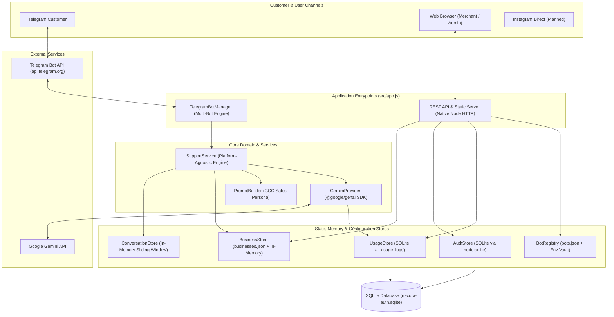
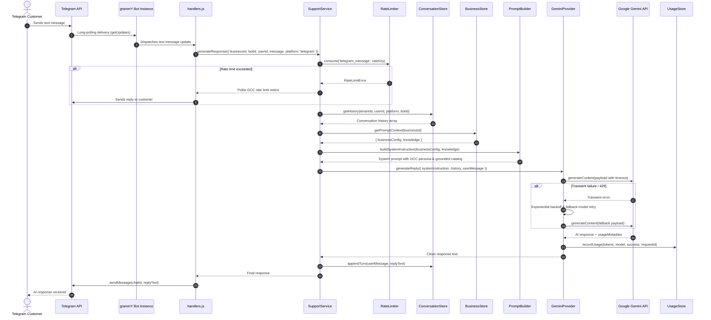
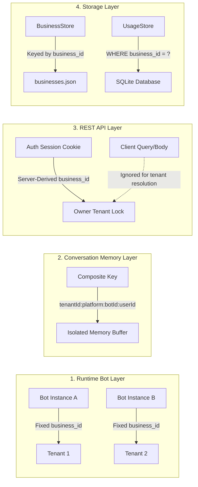

# Nexora AI — System Architecture

## 1. High-Level Architecture Overview

Nexora AI is structured as a modular, single-process, multi-tenant application. It decouples channel-specific I/O (such as Telegram long-polling) from core domain services (customer support, conversational sales, and AI prompt synthesis).



---

## 2. Directory Structure & Key Files

```text
c:\Users\RDP\Desktop\Nexora-AI-main\
├── data/
│   └── nexora-auth.sqlite           # Persistent SQLite database (users, sessions, AI usage)
├── docs/                            # Project documentation system
├── public/                          # Static Arabic RTL single-page dashboard assets
│   ├── css/style.css                # Responsive stylesheet with CSS custom properties
│   ├── js/app.js                    # Vanilla ES Modules frontend application
│   └── index.html                   # Dashboard HTML entrypoint with RTL viewport
├── src/
│   ├── ai/
│   │   ├── geminiProvider.js        # Official @google/genai client with timeout & retries
│   │   ├── modelPricing.js          # Verified pricing tiers and cost calculation engine
│   │   └── promptBuilder.js         # GCC dialect persona & catalog prompt compiler
│   ├── analytics/
│   │   └── usageStore.js            # SQLite-backed AI token and attempt logger
│   ├── api/
│   │   └── server.js                # Native Node.js REST API & static file HTTP server
│   ├── auth/
│   │   ├── authStore.js             # SQLite user accounts & session management
│   │   ├── passwordHasher.js        # crypto.scrypt hashing with timingSafeEqual
│   │   └── seedAdmin.js             # CLI tool to provision admin and owner accounts
│   ├── config/
│   │   ├── botRegistry.js           # Bot registry resolving token variable pointers
│   │   ├── bots.json                # Multi-bot registry configuration
│   │   ├── businesses.json          # Multi-tenant business catalog & store policies
│   │   ├── businessKnowledge.js     # Schema validator for business knowledge
│   │   ├── businessStore.js         # In-memory cached CRUD store for businesses
│   │   ├── defaultKnowledge.json    # Fallback/legacy single-store catalog
│   │   └── env.js                   # Zod-based startup environment validation
│   ├── memory/
│   │   └── conversationStore.js     # In-memory sliding-window conversation history
│   ├── middleware/
│   │   ├── inputValidator.js        # Message length validation & character sanitization
│   │   └── rateLimiter.js           # Sliding-window in-memory rate limiter
│   ├── services/
│   │   └── supportService.js        # Platform-agnostic sales & support engine
│   ├── telegram/
│   │   ├── bot.js                   # grammY bot factory bound to a specific tenant
│   │   ├── botManager.js            # Central multi-bot runtime manager
│   │   └── handlers.js              # Telegram command and message handlers
│   ├── utils/
│   │   ├── errors.js                # Custom application error hierarchy
│   │   ├── localization.js          # GCC dialect, currency, and language detection
│   │   └── logger.js                # Structured Pino logger with secret redaction
│   └── app.js                       # Top-level composition root & startup orchestrator
├── tests/                           # Vitest automated test suites (100% mocked offline)
├── .env                             # Local active environment variables (untracked)
├── .env.example                     # Environment configuration reference template
├── .gitignore                       # Git exclusion rules for secrets, DB, and logs
└── package.json                     # Project manifest and scripts
```

---

## 3. Core Components & Responsibilities

### 3.1 Telegram Multi-Bot Manager (`TelegramBotManager`)
* **File:** `src/telegram/botManager.js`
* **Role:** Manages the concurrent lifecycle of multiple grammY `Bot` instances.
* **Mechanism:**
  - Iterates over active bots registered in `src/config/bots.json`.
  - Verifies that the associated `business_id` exists in `BusinessStore`.
  - Resolves the Telegram token securely from the environment vault via `BotRegistry`.
  - Prevents duplicate bot IDs or duplicate tokens from running simultaneously.
  - Launches independent long-polling loops and provides safe programmatic start, stop, and restart methods.

### 3.2 Support Service (`SupportService`)
* **File:** `src/services/supportService.js`
* **Role:** Channel-agnostic coordinator for incoming inquiries.
* **Mechanism:**
  - Enforces per-user rate limiting via `RateLimiter`.
  - Enforces text length restrictions and sanitizes control characters via `inputValidator`.
  - Retrieves active conversation history from `ConversationStore`.
  - Compiles business context from `BusinessStore` using `PromptBuilder`.
  - Requests AI generation through `GeminiProvider`.
  - Persists the new exchange turn back to `ConversationStore`.
  - Translates unexpected failures into localized, polite Arabic/English apologies.

### 3.3 Gemini AI Provider (`GeminiProvider`)
* **File:** `src/ai/geminiProvider.js`
* **Role:** Production wrapper around the official Google Gen AI SDK (`@google/genai`).
* **Mechanism:**
  - Wraps generation calls in strict timeouts using `Promise.race()`.
  - Implements exponential backoff retries for transient errors (HTTP 429, 500, 502, 503, 504, network drops).
  - Supports automatic model failover through a priority list (`gemini-3.5-flash-lite` -> `gemini-3.5-flash` -> `gemini-3.8-flash`).
  - Records real token counts (`promptTokens`, `candidatesTokens`, `totalTokens`) to `UsageStore`.

### 3.4 Business Store (`BusinessStore`)
* **File:** `src/config/businessStore.js`
* **Role:** Central data store for tenant profiles, catalogs, offers, and store policies.
* **Mechanism:**
  - Reads and validates `src/config/businesses.json`.
  - Maintains an in-memory cache for fast read access during AI prompt building.
  - Exposes transactional updates that synchronize back to `businesses.json`.
  - Ensures live updates (e.g. price change via dashboard) immediately affect subsequent AI prompt generation without bot restarts.

### 3.5 Auth Store (`AuthStore`)
* **File:** `src/auth/authStore.js`
* **Role:** SQLite-backed user authentication and session management.
* **Mechanism:**
  - Uses synchronous SQLite via Node.js native `node:sqlite` (`DatabaseSync`).
  - Manages `users` table with roles (`platform_admin`, `business_owner`).
  - Manages `sessions` table with CSRF tokens and TTL-based expiration.
  - Enforces strict foreign key constraints and cascade deletion.

---

## 4. Telegram Message Flow

The sequence diagram below traces an incoming message from a Telegram customer through to the response delivery:



---

## 5. Multi-Tenant Data Isolation Strategy

Data isolation across tenants is enforced at four distinct architectural layers:



1. **Bot Registration Isolation:** Each bot in `src/config/bots.json` is hardcoded to a single `business_id`. Handlers never accept a user-supplied business ID; the bot context supplies it implicitly.
2. **Conversation Memory Isolation:** Cache keys in `ConversationStore` are strictly composed as `businessId:platform:botId:userId`. Customer A on Store 1 can never access or leak into Customer A's session on Store 2.
3. **API Session Derivation:** On all `/api/my-business/*` endpoints, the `business_id` is derived **exclusively** from the authenticated server-side session. Any attempt by a client to submit another merchant's `business_id` in URL parameters, query strings, or JSON bodies is ignored.
4. **Analytics Database Isolation:** All queries in `UsageStore` require an explicit `business_id` parameter and filter by `WHERE business_id = ?`. Cross-tenant aggregation is permitted only to callers authenticated as `platform_admin`.

---

## 6. Gemini Integration Architecture

Nexora AI interfaces with Google's Gemini models through `@google/genai`:

* **Client Construction:** Initialized in `GeminiProvider` using `new GoogleGenAI({ apiKey })`.
* **Prompt Engineering (`PromptBuilder`):**
  - Generates a Saudi/Gulf sales consultant persona.
  - Injects business identity (currency, country, return policy, delivery conditions).
  - Grounded catalog serialization: Formats products, variants, prices, and active offers into Markdown tables.
  - Strict negative constraints: Never invent prices, never guarantee out-of-stock items, always recommend contacting human support when data is absent.
* **Fault Tolerance & Model Failover:**
  - Configurable request timeout (default: 20,000ms) enforced via `Promise.race()`.
  - Controlled retry mechanism (default: 2 retries) with exponential delay calculation:
    $$\text{backoffMs} = \text{baseDelay} \times 2^{\text{attempt}}$$
  - Transient error detection covering status codes `408`, `429`, `500`, `502`, `503`, and `504`.
  - Fallback model cycle: `gemini-3.5-flash-lite` -> `gemini-3.5-flash` -> `gemini-3.8-flash`.
* **Cost Tracking:**
  - Extracts prompt, candidate, and total token counts from `usageMetadata`.
  - Logs every attempt (successful or failed) with duration, request ID, and error code.
  - Rates token consumption against verified registry prices in `src/ai/modelPricing.js`.

---

## 7. Authentication, Sessions & Security Architecture

### Password Storage
* **Algorithm:** `crypto.scrypt` with a cryptographically secure random 16-byte salt.
* **Storage Format:** `scrypt$saltHex$derivedKeyHex`.
* **Verification:** Constant-time verification using `crypto.timingSafeEqual` to neutralize timing side-channel attacks.

### Session Lifecycle
* **Generation:** Generated via `crypto.randomBytes(32).toString('hex')` on successful login to prevent session fixation.
* **Delivery:** Delivered exclusively via HTTP cookies named `nexora_session` with attributes:
  - `HttpOnly`: Prevents JavaScript access and XSS theft.
  - `SameSite=Strict`: Protects against Cross-Site Request Forgery.
  - `Secure`: Enabled automatically when `NODE_ENV=production`.
  - `Path=/`: Scoped to the entire origin.
* **CSRF Protection:** State-changing requests (`POST`, `PUT`, `PATCH`, `DELETE`) require an `X-CSRF-Token` header that is verified against the session's stored CSRF token using `crypto.timingSafeEqual`.
* **Brute-Force Protection:** `/api/auth/login` is guarded by `RateLimiter` keyed on `clientIp:email`, allowing a maximum of 5 attempts per 60-second window.

### Secret Redaction in Logs
The custom Pino logger in `src/utils/logger.js` automatically redacts sensitive patterns (Telegram bot tokens, Google API keys, Bearer tokens) across all log fields, error objects, and nested metadata before writing to stdout.

---

## 8. Database & Storage Architecture

Nexora AI employs a **hybrid storage model**:

| Storage Medium | Technology | Data Stored | Concurrency & Persistence |
| :--- | :--- | :--- | :--- |
| **Authentication & Sessions** | SQLite (`node:sqlite` `DatabaseSync`) | `users`, `sessions` | File-backed (`data/nexora-auth.sqlite`). Foreign key cascade enabled. Synchronous transactions. |
| **AI Usage Logs** | SQLite (`node:sqlite` `DatabaseSync`) | `ai_usage_logs` | Indexed by `(business_id, created_at)` and `(model, created_at)`. |
| **Business Catalogs** | JSON File (`src/config/businesses.json`) | Products, prices, offers, policies | In-memory cache with atomic file writes on administrative changes. |
| **Bot Registry** | JSON File (`src/config/bots.json`) | Bot IDs, usernames, token environment pointers | In-memory read at startup; token resolved from runtime environment. |
| **Conversation Memory** | In-Memory `Map` | Message turns per customer | Fast volatile storage. Sliding window (20 messages). 24-hour TTL expiration. |

---

## 9. Dashboard-to-API Communication

The web frontend (`public/js/app.js`) is an authenticated Arabic RTL Single-Page Application:

```mermaid
sequenceDiagram
    autonumber
    participant Browser as Frontend SPA (public/js/app.js)
    participant Server as REST API (src/api/server.js)
    participant DB as SQLite / BusinessStore

    Note over Browser,Server: 1. Authentication Flow
    Browser->>Server: POST /api/auth/login (email, password)
    Server->>Server: Validate scrypt hash, generate session & CSRF token
    Server-->>Browser: Set-Cookie: nexora_session; JSON { user, csrfToken }
    Browser->>Browser: Store csrfToken in memory (never localStorage)

    Note over Browser,Server: 2. Authenticated Data Retrieval
    Browser->>Server: GET /api/my-business (Cookie sent automatically)
    Server->>Server: Validate session, derive business_id
    Server->>DB: Fetch business profile & catalog
    Server-->>Browser: JSON { business }

    Note over Browser,Server: 3. State-Changing Request with CSRF
    Browser->>Server: POST /api/my-business/products (Header: X-CSRF-Token)
    Server->>Server: Verify session & timingSafeEqual(csrfToken)
    Server->>DB: Save product to BusinessStore
    Server-->>Browser: 201 Created { product }
    Note over Server,DB: Live sync: Gemini bot immediately reflects updated products
```

